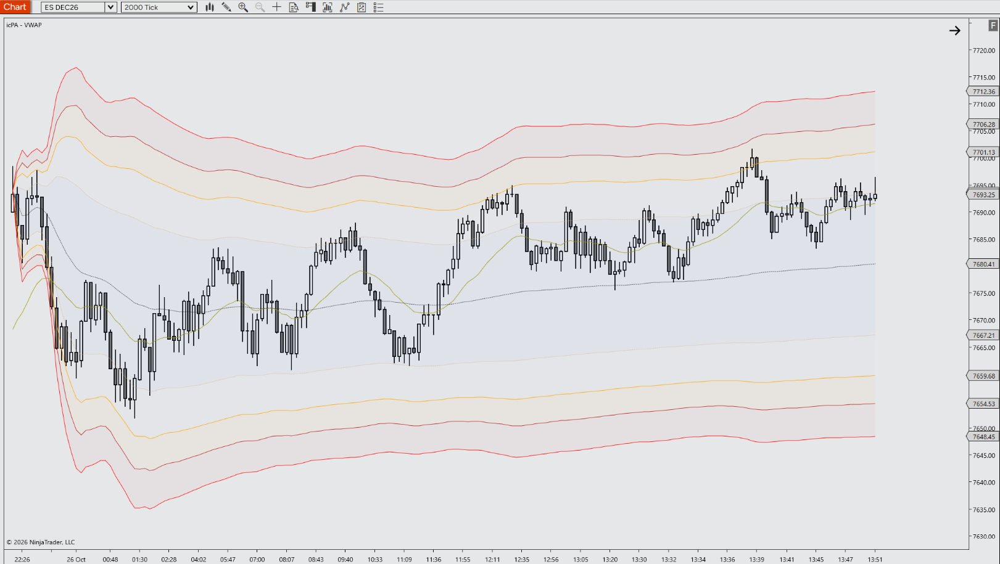

# icPA - VWAP for NinjaTrader 8

A specialized Indicator engineered for Price Action and Order Flow trading. It plots a session, weekly, monthly or custom-start VWAP with up to three time-zone aware anchor resets, five standard deviation bands and the previous segment's VWAP carried forward as a reference level.

---

## 📺 Video Walkthrough & Setup

Watch the complete breakdown of parameters, price action context, and chart examples on YouTube:

> **[▶ Click here to watch the full YouTube walkthrough](https://youtube.com/@icPriceAction)**

---

## ☕ Support the Project

All tools by **icPriceAction** are **100% free and open-source for personal trading use**. There are no paywalls, subscriptions, or locked features and there never will be!

Developing, optimizing for zero latency on multiple charts/instruments, and maintaining documentation and releases takes a **considerable amount of personal time and ongoing effort**. 

If this tool saves you screen time, improves your execution, or cleans up your charts, buying a coffee is the best way to support continued development:

  

> **[☕ Support Development on Buy Me a Coffee](https://buymeacoffee.com/icpriceaction)**

---

## ⚡ Key Features

- **Flexible VWAP periods and anchors:** Session, Week, Month or Custom Start periods. In Session mode, up to three anchors restart the VWAP at set times (default 09:30 New York), each in its own time zone (New York, Chicago, London, Frankfurt, Tokyo, Sydney, Exchange or Platform), so they follow daylight saving changes automatically. Turn off the session reset for an RTH-only VWAP.
- **Five standard deviation bands plus previous segment levels:** Layered band fills that break cleanly at every reset, with the previous segment's final VWAP (and optionally its bands) carried forward as dashed reference lines.
- **Z-Score output and tick precision:** A Z-Score value ((close − VWAP) / standard deviation) is available in the Data Box, Market Analyzer and strategies. An optional 1-tick calculation mode gives exact trade prices, tick-precise anchors and a true VWAP on Heiken Ashi charts.
- **PATS & Context Aligned:** Designed for Price Action principles and disciplined futures execution.
- **Zero Chart Lag:** Native C# execution optimized to prevent UI freezes on high-frequency tick charts.
- **Clean Visuals:** Complementary default palette that preserves candlestick clarity without chart clutter.
- **Fully Customizable:** Configure colors, thresholds, offsets, and alerts via the native NT8 settings panel.

---

## ⚠️ Prerequisites & Data Requirements

- Works on any chart type (time, tick, volume, range, Renko, Heiken Ashi) and any `Calculate` mode. **Tick Replay is not required.**
- Uses the instrument's volume. If the data feed provides no volume (some forex/CFD feeds), every bar is weighted equally and an on-chart notice is shown.
- On daily or higher charts, use the **Week**, **Month** or **Custom Start** period. Anchors are disabled there.
- On Heiken Ashi charts, enable **Use Tick Data For Precision** for a true VWAP (Heiken Ashi bars use synthetic prices).
- **Use Tick Data For Precision** needs tick history from your data provider and loads more data on long lookbacks. If no tick history is available, the indicator falls back to chart bars and shows a notice.
- When called from your own strategy with `useTickData` set to true, the strategy must add `AddDataSeries(BarsPeriodType.Tick, 1)` itself.

---

## 📥 Installation Guide

1. Head to the **[Releases](https://github.com/icPriceAction/vwap/releases)** tab of this repository.
2. Download the latest release `.zip` file.
   - *Note: Do NOT extract or unzip the file.*
3. Open **NinjaTrader 8**.
4. In the Control Center, navigate to:
   `Tools` ➔ `Import` ➔ `NinjaScript Add-On...`
5. Select the downloaded `.zip` file and click **Open**.
6. A success dialog will appear confirming the tool has been imported.
7. Open any chart, press `Ctrl + I`, find **icPA - VWAP** in the **icPA** folder, and add it.

---

## ⚙️ Parameters & Configuration

| Parameter | Group | Type | Default | Description |
| :--- | :--- | :--- | :--- | :--- |
| VWAP Period | 1. General | Session / Week / Month / Custom Start | Session | When the VWAP resets. Session: each session start (optional) plus the anchors. Week / Month: first session of each trading week / month. Custom Start: once, at the Custom Start date and time. |
| Reset At Session Start | 1. General | Bool | True | Session period only. Turn off for a VWAP that resets only at the anchors (e.g. RTH-only from 09:30 New York). |
| Custom Start | 1. General | Date/Time | Today, 00:00 | Custom Start period only. Date and time the VWAP starts, in the platform time zone. |
| Enable Anchor 1 | 1. General | Bool | True | Session period only. Starts a new VWAP segment at Anchor Time 1. |
| Anchor Time 1 | 1. General | Time | 09:30 | Time of day the segment starts, in Anchor 1 Time Zone. |
| Anchor 1 Time Zone | 1. General | Time zone | New York | Exchange, Platform, New York, Chicago, London, Frankfurt, Tokyo or Sydney. |
| Enable Anchor 2 | 1. General | Bool | False | Session period only. Starts a new VWAP segment at Anchor Time 2. |
| Anchor Time 2 | 1. General | Time | 08:00 | Time of day the segment starts, in Anchor 2 Time Zone. |
| Anchor 2 Time Zone | 1. General | Time zone | London | Time zone Anchor Time 2 is expressed in. |
| Enable Anchor 3 | 1. General | Bool | False | Session period only. Starts a new VWAP segment at Anchor Time 3. |
| Anchor Time 3 | 1. General | Time | 02:00 | Time of day the segment starts, in Anchor 3 Time Zone. |
| Anchor 3 Time Zone | 1. General | Time zone | London | Time zone Anchor Time 3 is expressed in. |
| Use Tick Data For Precision | 1. General | Bool | False | Calculates on 1-tick data: exact trade prices, tick-precise anchors, true VWAP on Heiken Ashi. Loads full tick history. |
| Show Previous VWAP | 2. Visuals | Bool | True | Carries the previous segment's final VWAP forward as a dashed line. Style it under Plots > PlotPrevVWAP. |
| Show Previous Bands | 2. Visuals | Bool | False | Also carries the previous segment's final bands forward as dashed lines in each band's colour. |
| Show Band 1 | 2. Visuals | Bool | True | Plots band 1 and its fill. |
| Band 1 Fill Color | 2. Visuals | Brush | Cornflower Blue | Fill colour between the VWAP and band 1. |
| Band 1 Fill Opacity | 2. Visuals | Int (0-100) | 6 | Fill opacity (0 = no fill). |
| Show Band 2 | 2. Visuals | Bool | True | Plots band 2 and its fill. |
| Band 2 Fill Color | 2. Visuals | Brush | Cornflower Blue | Fill colour between band 2 and the nearest visible inner band. |
| Band 2 Fill Opacity | 2. Visuals | Int (0-100) | 2 | Fill opacity (0 = no fill). |
| Show Band 3 | 2. Visuals | Bool | True | Plots band 3 and its fill. |
| Band 3 Fill Color | 2. Visuals | Brush | Dark Orange | Fill colour between band 3 and the nearest visible inner band. |
| Band 3 Fill Opacity | 2. Visuals | Int (0-100) | 4 | Fill opacity (0 = no fill). |
| Show Band 4 | 2. Visuals | Bool | True | Plots band 4 and its fill. |
| Band 4 Fill Color | 2. Visuals | Brush | Brown | Fill colour between band 4 and the nearest visible inner band. |
| Band 4 Fill Opacity | 2. Visuals | Int (0-100) | 4 | Fill opacity (0 = no fill). |
| Show Band 5 | 2. Visuals | Bool | False | Plots band 5 and its fill. |
| Band 5 Fill Color | 2. Visuals | Brush | Red | Fill colour between band 5 and the nearest visible inner band. |
| Band 5 Fill Opacity | 2. Visuals | Int (0-100) | 5 | Fill opacity (0 = no fill). |
| Band 1 Deviation | 3. Offsets & Thresholds | Double (0-10) | 1.28 | Band 1 distance from VWAP, in standard deviations. |
| Band 2 Deviation | 3. Offsets & Thresholds | Double (0-10) | 2.01 | Band 2 distance from VWAP, in standard deviations. |
| Band 3 Deviation | 3. Offsets & Thresholds | Double (0-10) | 2.51 | Band 3 distance from VWAP, in standard deviations. |
| Band 4 Deviation | 3. Offsets & Thresholds | Double (0-10) | 3.1 | Band 4 distance from VWAP, in standard deviations. |
| Band 5 Deviation | 3. Offsets & Thresholds | Double (0-10) | 4.0 | Band 5 distance from VWAP, in standard deviations. |

**Plots:** Line colour, width and dash style for the VWAP, each band and the previous VWAP are set in the standard **Plots** section (`PlotVWAP`, `PlotVWAP1U` … `PlotVWAP5L`, `PlotPrevVWAP`). `PlotZScore` is not drawn on the chart; it is available in the Data Box, Market Analyzer and strategies.

**Strategy use:** `icPAVWAP(vwapPeriod, resetAtSessionStart, customStartTime, enableAnchor1, anchorTime1, anchorTimeZone1, useTickData)`. Anchors 2-3 and the band settings use their defaults when called from a strategy.

---

## 📝 Changelog

- **v1.5.3**              - Initial public release. Cleaned and optimized by icPriceAction.
- **v1.5.2**              - Fixed Week/Month resets on daily charts; clearer anchor checks; code comments reviewed.
- **v1.5.1**              - Auto Scale defaults to off; the Z-Score plot stays excluded from autoscaling.
- **v1.5.0**              - Added VWAP Period (Session/Week/Month/Custom Start), Reset At Session Start, Custom Start, previous segment VWAP and bands, Z-Score plot, strategy parameters.
- **v1.4.0**              - Custom rendering of visible bars only, clean breaks at every segment, Show Band toggles.
- **v1.3.2**              - Removed Price Source input; the VWAP always uses typical price (H+L+C)/3.
- **v1.3.1**              - Chart bars used by default; optional 'Use Tick Data For Precision' 1-tick engine.
- **v1.3.0**              - Secondary-series calculation engine, weighted Welford variance, faster anchor detection.
- **v1.2.0**              - Per-bar sums (safe on OnEachTick), anchor timing fix, anchor time zones, fill colour serialization, equal weighting when no volume data.
- **v1.1.0**              - Up to three sequential anchor points that reset the VWAP.
- **v1.0.6**              - Added anchor end time parameters (replaced in v1.1.0).
- **v1.0.5**              - Compilation fix in first-bar date detection.
- **v1.0.4**              - Stateless detection of the first calculation bar.
- **v1.0.3**              - State tracking for the first calculation bar.
- **v1.0.2**              - Deviation bands now converge on the first bar.
- **v1.0.1**              - Anchor time is now applied correctly.
- **v1.0.0**              - Initial anchored VWAP implementation.

---

## 🐛 Bug Reports & Feature Requests

Found an issue or have an enhancement idea?
Please submit an issue on the [Issues tab](https://github.com/icPriceAction/vwap/issues).

---

## License

Free for personal trading use. Commercial resale, redistribution, or repackaging is strictly prohibited. See [LICENSE](LICENSE).

---

## ⚖️ Disclaimer

Futures trading involves substantial risk of loss and is not suitable for every investor. All indicators, drawing tools, strategies, and documentation provided by **icPriceAction** are for educational and analytical purposes only. Nothing herein constitutes financial or investment advice. Automated strategies can lose money and may behave differently in live markets than in simulation or backtests.

NinjaTrader® is a registered trademark of NinjaTrader, LLC. icPriceAction is an independent developer with no official affiliation to NinjaTrader, LLC.